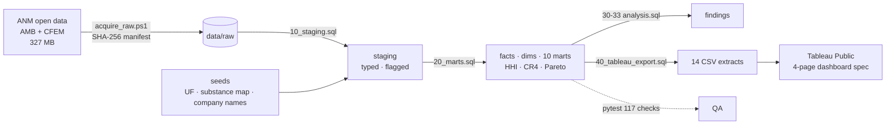

# Brazilian Mining Performance & Market Concentration

**SQL-first analytics project** (DuckDB) on official open data from Brazil's mining regulator, ANM. It measures how the
value of Brazilian mineral production evolved from 2010 to 2025, which states and commodities drive it, and how concentrated
the sector is geographically, by commodity and by company.

> **Status (2026-11-18):** pipeline, analysis, tests (117/117 passing) and Tableau-ready extracts are complete. The Tableau
> Public dashboard is **specified** ([build guide](docs/TABLEAU_BUILD_GUIDE.md)) but **not yet built or published**.
> Tableau Public link: *to be added after publishing*.

## Business questions
1. How did the value of mineral sales evolve, and was it price or volume?
2. Which commodities and states drive the sector, and is dependence on iron ore falling?
3. How concentrated is the sector, and is that concentration geographic, commodity mix or company?
4. Where are the mining royalties (CFEM) collected, and who pays them?

## Key findings (from the data; [full list](docs/ANALYSIS_FINDINGS.md))
- Beneficiated sales grew from **R$ 61.4 bn (2010) to R$ 281.7 bn (2025)** in nominal terms. For iron ore, gold and copper, which make up 82 % of the value, unit value rose more than volume.
- Iron ore's share fell from **75.8 % (2021) to 56.7 % (2025)**. Gold grew at an 18.6 % CAGR from 2015 to 2025.
- Minas Gerais and Pará hold **74.7 %** of value. Pará led from 2018 to 2021 and again in 2024.
- Company concentration is high in iron ore (HHI 5,104; **VALE S.A. pays 70.6 %** of iron ore CFEM) and copper, and low in gold (HHI 1,166).
- Extraction in two municipalities in Pará generates **29.7 %** of all CFEM collected.
- **Data quality:** the Feb 2024 CFEM file contains a systematic duplicate export (R$ 296 M). Without correcting it, 2024 growth would read +12.8 % instead of +8.4 %.

## Architecture



## Run it (Windows, free tools)

```powershell
cd C:\Tableau\industrial-data-analytics
py -3.12 -m venv .venv
.venv\Scripts\python.exe -m pip install -r mining-intelligence\requirements.txt
```

```powershell
cd mining-intelligence
powershell -ExecutionPolicy Bypass -File src\run_pipeline.ps1 -Download
```

```powershell
..\.venv\Scripts\python.exe -m pytest tests -v
```

The pipeline downloads about 327 MB once, builds `data/interim/mining.duckdb` in about 10 s and writes `tableau/data/*.csv`.
Run `src\run_pipeline.ps1` without `-Download` to rebuild from the files already on disk.
Tested on Windows 11 with Python 3.12.10, duckdb 2.0.0 and pytest 9.2.0.

## Repository map

| Path | Content |
|---|---|
| `src/` | `acquire_raw.ps1`, `run_pipeline.ps1`, `run_sql.py` (SQL runner), `lookup_company_names.py` |
| `sql/` | `00–02` profiling · `10` staging · `20` marts · `19/29` checks · `30–33` analysis · `40` Tableau export |
| `seeds/` | `uf.csv`, `amb_substance.csv`, `substance_map.csv` (148 CFEM names → 48 groups), `company_names.csv` |
| `tests/` | pytest suites and `results/` (JUnit evidence) |
| `tableau/` | `data/*.csv` extracts and `data_dictionary.csv` |
| `docs/` | everything below |

## Documentation

| Document | Purpose |
|---|---|
| [DATA_SOURCES.md](docs/DATA_SOURCES.md) | Official sources, URLs, licence, snapshot |
| [data_source_evaluation.md](docs/data_source_evaluation.md) | Phase 1 candidate comparison matrix |
| [DATA_PROFILE.md](docs/DATA_PROFILE.md) | Full profiling of the raw files |
| [ETL_PIPELINE.md](docs/ETL_PIPELINE.md) | Layers, grain, transformation rules T1–T15 |
| [DATA_DICTIONARY.md](docs/DATA_DICTIONARY.md) | Every exported column |
| [DATA_QUALITY_REPORT.md](docs/DATA_QUALITY_REPORT.md) | Quality indicators and the issue register |
| [ANALYSIS_METHODOLOGY.md](docs/ANALYSIS_METHODOLOGY.md) · [ANALYSIS_FINDINGS.md](docs/ANALYSIS_FINDINGS.md) | Methods and results |
| [KPI_DEFINITIONS.md](docs/KPI_DEFINITIONS.md) | K1–K19 with reference values |
| [TABLEAU_DATA_MODEL.md](docs/TABLEAU_DATA_MODEL.md) · [TABLEAU_BUILD_GUIDE.md](docs/TABLEAU_BUILD_GUIDE.md) | Dashboard model and build procedure |
| [TEST_REPORT.md](docs/TEST_REPORT.md) | Executed tests and failures found |
| [LIMITATIONS.md](docs/LIMITATIONS.md) · [CHANGELOG.md](docs/CHANGELOG.md) | Constraints and history |
| [PORTFOLIO_KIT.md](docs/PORTFOLIO_KIT.md) | Case study and channel texts |

Data: ANM, *Agência Nacional de Mineração*, open data. Company names: Receita Federal CNPJ registry via BrasilAPI.
Values are nominal R$. CFEM is a royalty, not revenue.
