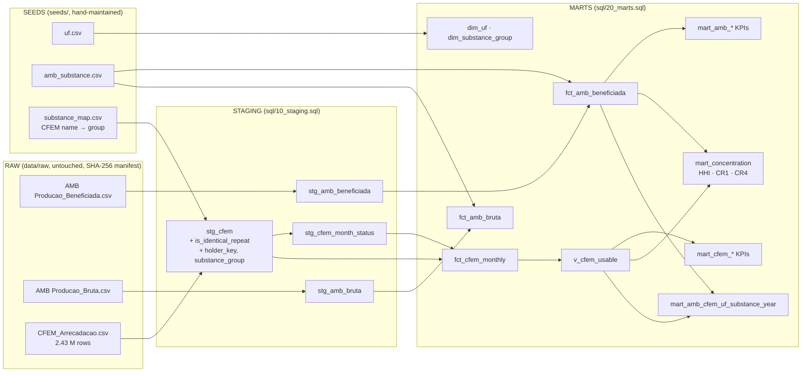

# ETL Pipeline — Mining Intelligence (DuckDB SQL)

## Architecture



## Run (Windows)

```powershell
cd C:\Tableau\industrial-data-analytics\mining-intelligence
powershell -ExecutionPolicy Bypass -File src\run_pipeline.ps1            # build from existing raw files (~7 s)
powershell -ExecutionPolicy Bypass -File src\run_pipeline.ps1 -Download  # re-download raw first (~327 MB)
```

The output database is `data/interim/mining.duckdb` (not versioned). Check results are written to `data/interim/checks/*.csv`.

## Layers and grain

| Table | Grain | Rows (2026-11-18 build) |
|---|---|---|
| `stg_amb_beneficiada` | one published AMB record | 3,982 |
| `stg_amb_bruta` | one published AMB ROM record | 6,307 |
| `stg_cfem` | one CFEM collection line | 2,434,190 |
| `stg_cfem_month_status` | month | 284 |
| `fct_amb_beneficiada` | base year × UF × AMB substance | 3,953 |
| `fct_amb_bruta` | base year × UF × AMB substance | 6,233 |
| `fct_cfem_monthly` | month × UF × municipality × substance group × holder key | 1,335,221 |
| `mart_amb_uf_substance_year` | year × UF × substance group | 3,929 |
| `mart_amb_uf_year` | year × UF | 416 |
| `mart_amb_substance_year` | year × substance group | 754 |
| `mart_amb_national_year` | year | 16 |
| `mart_cfem_uf_year` | year × UF | 638 |
| `mart_cfem_substance_year` | year × substance group | 1,088 |
| `mart_cfem_municipality_year` | year × IBGE municipality | 54,125 |
| `mart_cfem_monthly` | month × substance group (dense) | 13,230 |
| `mart_cfem_holder_substance_year` | year × substance group × company (CNPJ root) | 158,683 |
| `mart_concentration` | year × concentration type × scope | 1,789 |
| `mart_amb_cfem_uf_substance_year` | year × UF × substance group (2010–2025) | 5,596 |

## Transformation rules

| # | Rule | Where | Effect (measured) |
|---|---|---|---|
| T1 | Explicit CSV dialect: `,` delimiter, `"` quote, latin-1. The metadata's `;` is wrong | staging | — |
| T2 | Decimal comma → DOUBLE via the `br_num()` macro. R$ rounded to 2 dp | staging | 0 parse failures on value fields |
| T3 | English snake_case names. UF upper-cased. Units lower-cased. Blank → NULL | staging | — |
| T4 | CFEM fully identical lines are flagged (`is_identical_repeat`), **not removed** | `stg_cfem` | 143,751 lines, R$ 325.07 M (0.44 %) |
| T5 | Company key = CNPJ root (first 8 digits) for PJ. Masked CPFs → "INDIVIDUALS (masked CPF)". Others → "UNIDENTIFIED" | `stg_cfem` | 334 PJ lines without a valid CNPJ |
| T6 | Substance harmonisation through `seeds/substance_map.csv` (148 CFEM names → 48 groups; the other 168 names, the long tail, fall to "Other (unmapped)"). Each mapping is tagged exact / synonym / judgment / ambiguous_use / no_amb_equivalent | `stg_cfem` | 99.96 % of value assigned to a named group (96.4 % with an AMB equivalent). 0.04 % "Other (unmapped)" |
| T7 | Month completeness: the national month total is compared with the trailing 12-month median. Below 50 % → `incomplete`. Before 2004 → `partial_history` | `stg_cfem_month_status` | Jul–Nov 2026 incomplete. 2002-08 → 2003-12 partial |
| T8 | AMB collapse: identical (qty, value) rows inside one year × UF × substance are counted once. Different rows are summed | `fct_amb_*` | 29 → 0 duplicate keys. Value reconciles with staging |
| T9 | Quantities are aggregated only when the group has a single unit. Otherwise NULL | marts | — |
| T10 | YoY only when the previous row is the calendar previous year and its value > 0 | marts | No YoY across gap years |
| T11 | Joins only between tables pre-aggregated to the same grain (AMB × CFEM FULL JOIN with `match_status`) | `mart_amb_cfem_*` | 3,414 both / 515 AMB-only / 1,667 CFEM-only |
| T12 | Analysis views exclude `incomplete` and `partial_history` months. 2026 is labelled "YTD Jan–Jun (provisional)" | `v_cfem_usable` | R$ 74.31 bn usable of R$ 74.54 bn |

## SQL techniques used (non-artificial)

- **CTEs** in every mart (`base → lagged/ranked → final`).
- **CASE WHEN** for status labels, guarded ratios and the HHI band.
- **Window functions:** `LAG` (YoY, rank change), `RANK`/`ROW_NUMBER` (rankings, CR4), `SUM() OVER` (shares, cumulative Pareto share), `median() OVER` with a 12-row frame (completeness rule), 12-month `ROWS BETWEEN` frame (rolling CFEM).
- **JOIN** types: inner joins to seeds and dimensions, `LEFT JOIN` for the substance map, `FULL JOIN` for AMB×CFEM, `ANTI JOIN` in the checks, `CROSS JOIN` for a dense month spine.
- **GROUP BY ALL**, `FILTER`, `arg_max`, macros (`br_num`, `cfem_year_status`).

## Checks run at the end of every build

`sql/19_staging_checks.sql` and `sql/29_mart_checks.sql`: value reconciliation staging → facts → marts (AMB R$ 2.388 tn, CFEM R$ 74.54 bn / 74.31 bn usable), single unit per fact key, seed completeness, label consistency, integration match. These are inspection queries. The pass/fail assertion suite is Phase 7 (`tests/`).
