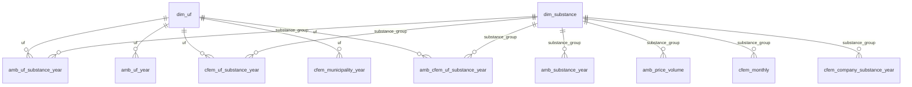

# Tableau Data Model — Mining

All extracts are in `tableau/data/` (14 CSVs, about 6.7 MB, rebuilt by `src\run_pipeline.ps1`). Columns are described in
[DATA_DICTIONARY.md](DATA_DICTIONARY.md). The model is a **set of pre-aggregated tables, one per grain**. Each sheet uses one
fact table and the dimensions only. Fact tables are **never related to each other**, because their grains and measures differ
(AMB value vs CFEM royalty).

Standalone tables (no relationship needed): `amb_national_year`, `concentration` (scope is free text, either a group or a total),
`metadata`.

## Relationships (Tableau "logical layer")

| Left | Right | Fields | Cardinality | Referential integrity |
|---|---|---|---|---|
| `dim_uf` | each table with `uf` | `uf = uf` | one-to-many | Some records match (`N/A` UF rows in CFEM have no dimension row) |
| `dim_substance` | each table with `substance_group` | `substance_group = substance_group` | one-to-many | All records match (tested) |

Use **relationships, not joins**. Tableau then aggregates each table at its native grain, so dimension rows are never duplicated.

## Grain and safe aggregation

| Table | Grain | Additive measures | Non-additive (do **not** SUM) |
|---|---|---|---|
| `amb_national_year` | year | `sale_value_brl` (across years only with care: nominal) | `value_yoy` |
| `amb_uf_year` | year × UF | `sale_value_brl` | shares, ranks, YoY, cumulative share |
| `amb_substance_year` | year × group | `sale_value_brl` | `production_qty` across groups, shares, ranks, YoY |
| `amb_uf_substance_year` | year × UF × group | `sale_value_brl`; `production_qty` **within one group** | shares, YoY |
| `amb_price_volume` | year × group | — | everything (log-point effects, unit value) |
| `cfem_uf_substance_year` | year × UF × group | `cfem_brl` | `n_holders` (distinct count) |
| `cfem_municipality_year` | year × municipality | `cfem_brl` | rank |
| `cfem_monthly` | month × group | `cfem_brl` | rolling and same-month-LY (use as is) |
| `cfem_company_substance_year` | year × group × company (top 10 + remainder) | `cfem_brl` within one group | shares |
| `concentration` | year × type × scope | — | everything (indices) |
| `amb_cfem_uf_substance_year` | year × UF × group | both value columns | ratio (recompute as SUM/SUM) |

Ratios shown at a coarser level must be recomputed in Tableau as `SUM(numerator) / SUM(denominator)`. Never average stored ratios.
The Phase 9 build guide gives the exact calculated fields.

## Field settings to apply after connecting

| Field | Setting |
|---|---|
| `uf` | Geographic role **State/Province**, with Country = Brazil (or use `iso_3166_2`) |
| `ibge_municipality_code`, `company_key` | Data type **String** (leading zeros) |
| `year` | Discrete dimension (String or Whole number, not a SUM measure) |
| `period_month` | Date |
| Booleans (`has_amb_equivalent`, `dq_flag_intermittent_series`) | Boolean |

## Size

The largest file is `cfem_municipality_year.csv` (54,125 rows, 3.8 MB); about 97 k rows in total. This is well inside the
Tableau Public limits (15 M rows per source, 10 GB per account).

## Municipal map: not provided
Tableau does not geocode Brazilian municipalities. A map would need municipal boundaries or centroids (e.g. the IBGE malhas
API). That is a separate dataset and was not added. Municipalities are shown as a ranked bar chart; states use a filled map.
