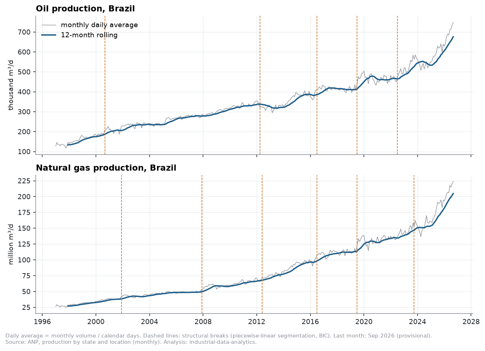
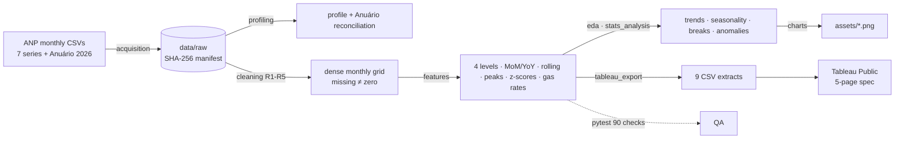

# Brazilian Oil & Gas Production Analytics

**Python-first analytics project** (pandas, NumPy, Matplotlib, pytest) on ANP's official monthly production statistics. It measures
how Brazilian oil and natural gas production evolved from 1997 to 2026, where it is produced, how stable it is, and what happens to
the gas that is produced.

> **Status (2026-11-18):** modular pipeline, analysis, charts, tests (90/90 passing) and Tableau-ready extracts are complete.
> The Tableau workbook is **built and verified** against the build guide's checklist
> ([`tableau/Brazilian_Oil_Gas_Production.twbx`](tableau/Brazilian_Oil_Gas_Production.twbx), screenshots in `assets/tableau_*.png`)
> but **not yet published**.
> Tableau Public link: *to be added after publishing*.

## Business questions
1. How much oil and gas does Brazil produce per day, and how fast is it growing?
2. Where is production concentrated (states, onshore vs offshore), and is that changing?
3. How stable is production: trend regimes, seasonality, volatility, statistical anomalies?
4. How is natural gas used: reinjected, flared, consumed, or made available?

## Key findings ([full list](docs/ANALYSIS_FINDINGS.md))
- **Record output in Sep 2026:** 748,985 m³/d of oil (≈ 4.71 M bbl/d) and 223.9 M m³/d of gas, both provisional.
- Steady long-run growth from 2000 to 2025: oil **+4.1 %/yr**, gas **+6.6 %/yr** (log-linear, R² ≥ 0.98). Growth paused in 2016–2022 and has accelerated since mid-2022 (oil +8.7 %/yr).
- **97.6 % of oil is offshore.** Rio de Janeiro's share fell to 67 % in 2015 and rose again to 88 % in 2025. Onshore oil is down 57 % since 2000.
- **More than half of the gas is now reinjected** (54.4 % in 2025, 19.1 % in 2010). Flaring and losses fell from 17.9 % (2000) to 2.8 %.
- A small but statistically significant **March–May dip** (permutation p ≤ 0.001). Volatility is rising, most of all onshore.



## Architecture



Modules in `src/oilgas/`: `config`, `readers`, `acquisition`, `profiling`, `cleaning`, `features`, `eda`, `stats_analysis`,
`charts`, `tableau_export` and `pipeline` (CLI). Every module runs on its own with `python -m oilgas.<module>`.
`notebooks/01_walkthrough.ipynb` is a thin, executed walkthrough that only calls these functions.

## Run it (Windows, free tools)

```powershell
cd C:\Tableau\industrial-data-analytics
py -3.12 -m venv .venv
.venv\Scripts\python.exe -m pip install -r oil-gas-intelligence\requirements.txt
```

```powershell
cd oil-gas-intelligence\src
..\..\.venv\Scripts\python.exe -m oilgas.pipeline --download
```

```powershell
cd ..
..\.venv\Scripts\python.exe -m pytest tests -v
```

The full run takes about 15 s after the download (about 3 MB). Tested on Windows 11 with Python 3.12.10, pandas 3.1.1,
numpy 2.5.5, matplotlib 3.11.2 and pytest 9.2.0.

## Documentation

| Document | Purpose |
|---|---|
| [DATA_SOURCES.md](docs/DATA_SOURCES.md) · [data_source_evaluation.md](docs/data_source_evaluation.md) | Sources and selection |
| [DATA_PROFILE.md](docs/DATA_PROFILE.md) | Profiling and Anuário reconciliation |
| [ETL_PIPELINE.md](docs/ETL_PIPELINE.md) | Modules, rules R1–R5, feature guard rails |
| [DATA_DICTIONARY.md](docs/DATA_DICTIONARY.md) | Every exported column |
| [DATA_QUALITY_REPORT.md](docs/DATA_QUALITY_REPORT.md) | Indicators and the issue register |
| [ANALYSIS_METHODOLOGY.md](docs/ANALYSIS_METHODOLOGY.md) · [ANALYSIS_FINDINGS.md](docs/ANALYSIS_FINDINGS.md) | Methods and results |
| [KPI_DEFINITIONS.md](docs/KPI_DEFINITIONS.md) | K1–K20 with reference values |
| [TABLEAU_DATA_MODEL.md](docs/TABLEAU_DATA_MODEL.md) · [TABLEAU_BUILD_GUIDE.md](docs/TABLEAU_BUILD_GUIDE.md) | Dashboard model and build |
| [TEST_REPORT.md](docs/TEST_REPORT.md) | Executed tests and failures found |
| [LIMITATIONS.md](docs/LIMITATIONS.md) · [CHANGELOG.md](docs/CHANGELOG.md) | Constraints and history |
| [PORTFOLIO_KIT.md](docs/PORTFOLIO_KIT.md) | Case study and channel texts |

Data: ANP, *Agência Nacional do Petróleo, Gás Natural e Biocombustíveis*, open data. Oil and gas are never summed; bbl/d is a
labelled conversion (1 m³ = 6.28981 bbl).
