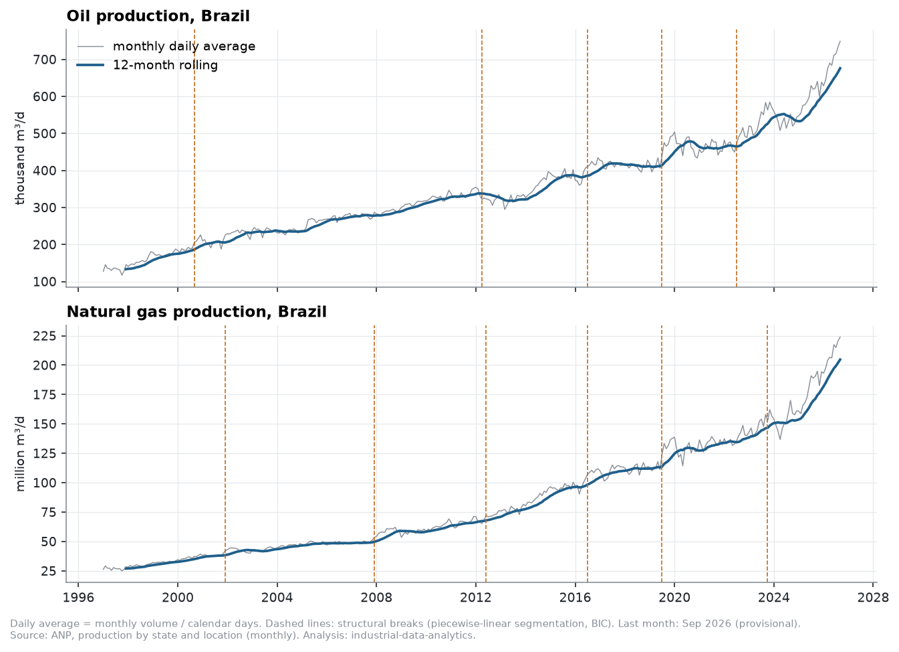
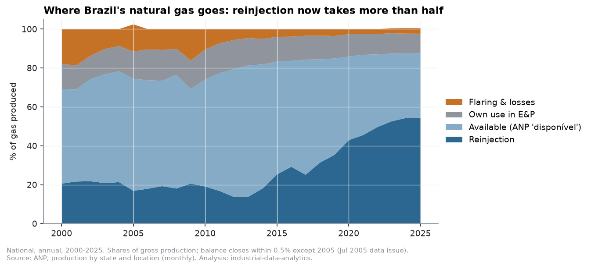

# Analysis Findings — Brazilian Oil & Gas Production Analytics

Phase 6. Produced by `oilgas.eda` and `oilgas.stats_analysis` (outputs in `data/processed/analysis/`, charts in `assets/`).
Data runs to Sep 2026; 2026 is provisional. Annual comparisons use complete years only (≤ 2025). Oil and gas are reported
separately; they are never summed. Statistical anomalies are **not** confirmed operational incidents, and no finding claims a cause.

## Headline findings

| # | Finding | Evidence |
|---|---|---|
| F1 | **Production is at a record and accelerating.** In Sep 2026 oil reached 748,985 m³/d (≈ 4.71 M bbl/d, labelled conversion) and gas 223.9 million m³/d. Both are the highest months in the series. Annual oil averaged 599,389 m³/d in 2025 (+12.0 % in volume) and gas 179.2 million m³/d (+16.7 %). | eda_descriptive, eda_annual |
| F2 | **Long-run growth is remarkably steady.** A log-linear fit of 2000–2025 gives oil +4.1 %/yr (R² 0.986) and gas +6.6 %/yr (R² 0.991). Gas has grown faster than oil in every window tested. | eda_trend_loglinear |
| F3 | **Growth comes in phases.** Piecewise-linear segmentation (BIC-selected, K = 6 oil / 7 gas) finds an oil plateau from mid-2016 to mid-2022 (−0.7 and −0.9 %/yr within its two segments). Since Jul 2022 oil has grown at +8.7 %/yr, and since Oct 2023 gas has grown at +15.9 %/yr. Two segment limits coincide with the 36-month minimum, so those dates are approximate. | stats_structural_breaks, _bic |
| F4 | **Brazil's oil is almost entirely offshore, and onshore is shrinking.** Offshore was 93.4 % of oil in 2015 and **97.6 % in 2025**. Onshore oil fell from 33,151 m³/d (2000) to 14,216 m³/d (2025), −57 %. Onshore gas rose (14.3 → 24.5 million m³/d), so the two onshore trends move in opposite directions. | eda_onshore_offshore, eda_annual |
| F5 | **Geographic concentration is rising again after a 2015 low.** RJ's share of oil was 79.6 % (2000), 67.1 % (2015) and **87.8 % (2025)**; the oil HHI across UFs went 6,426 → 4,869 → 7,760. Gas concentrated even faster: RJ rose from 40.0 % (2015) to 76.9 % (2025), and the HHI from 2,300 to 6,033. ES and SP gained share up to about 2015–2017 and have lost part of it since. | eda_regional_shares, eda_regional_hhi |
| F6 | **More than half of the gas produced is now reinjected.** The reinjection rate was 19.1 % (2010) and **54.4 % (2025)**. Over the same years the "available" share fell from 55.0 % to 33.4 %, and flaring & losses fell from 17.9 % (2000) to 2.8 % (2025). Offshore and onshore swapped positions: offshore reinjection went 5.5 % → 58.9 % (2010→2025), while onshore went 57.2 % → 26.0 %. | eda_gas_utilization_annual |
| F7 | **There is a small but statistically significant seasonal pattern.** Over 2011–2026 the daily average dips in **March–May**: April is −2.3 % (oil) and −3.6 % (gas) against the centred 12-month average. July–September and December run about 1–1.7 % above. Calendar month explains 17 % (oil) and 33 % (gas) of the detrended variance (permutation p = 0.001 / 0.0002). The data does not identify the cause. | eda_seasonality |
| F8 | **Month-to-month volatility has increased, most strongly onshore.** The std of the MoM change in the daily average for national gas was 2.6 % (1998–2009), 3.3 % (2010–19) and 4.0 % (2020–26). Onshore gas went 3.1 % → 6.4 % → 11.5 %. Months with |MoM| > 5 % rose from 6 % to 26 % for national gas. | stats_volatility_regimes |
| F9 | **National series have few statistical outliers.** With a robust z-score > 3.5 on the MoM change, national oil has 6 flagged months, all in 1997–2003, and national gas 1 (Jun 2020, +12.3 %). Most flags fall in the smaller onshore series (oil 20, gas 26). | stats_anomalies |

## Data-quality notes from this phase
- The Jul 2005 gas balance has a −28 % gap at national level. Annual 2005 rates therefore do not add up to 100 % (gap −2.4 %).
- Rates at UF level depend on ANP's allocation of volumes between states (see DATA_PROFILE), so they are labelled allocation-sensitive.

## Decision: no forecast
The brief allows a forecast only with a baseline and out-of-sample validation. None of the business questions above needs one,
and the series has visible regime changes (F3), so a forecast would add complexity without adding insight. This was a deliberate choice.

## Questions this data cannot answer
- Pre-salt vs post-salt split in monthly data (only in the annual Anuário tables).
- Field or operator attribution (the deferred well-level files).
- Causes of the accelerations, the plateau or the seasonal dip (maintenance, new production units, demand): the data has no event or operations log.
