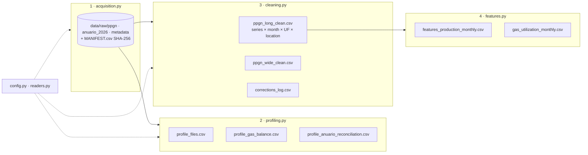

# ETL Pipeline — Oil & Gas Intelligence (Python)

## Architecture



Modules 5–8 (EDA, statistics, QA, Tableau export) follow in Phases 6–8.

## Run (Windows)

```powershell
cd brazil-resources-intelligence\oil-gas-intelligence\src
..\..\.venv\Scripts\python.exe -m oilgas.pipeline              # profile -> clean -> features (~5 s)
..\..\.venv\Scripts\python.exe -m oilgas.pipeline --download   # re-download raw first
..\..\.venv\Scripts\python.exe -m oilgas.cleaning              # any single step
```

## Module responsibilities

| Module | Responsibility |
|---|---|
| `config.py` | Paths, source URLs, units, UF reference, conversion constant (1 m³ = 6.28981 bbl) |
| `readers.py` | Parses the published layout only: BOM, `;`, decimal comma, PT month names. Fails loudly on layout change |
| `acquisition.py` | Byte-exact download and manifest (TLS verification on) |
| `profiling.py` | Describes the raw data: coverage, duplicates, zeros, gaps, gas balance, Anuário reconciliation |
| `cleaning.py` | Rules R1–R5 (below). Writes the corrections log |
| `features.py` | Aggregation levels and time-series features with guard rails |
| `pipeline.py` | CLI orchestration |

## Cleaning rules (from `corrections_log.csv`, build of 2026-11-18)

| Rule | Description | Rows affected |
|---|---|---|
| R1 | Common cut-off at the last month with national total > 0 in every series: **2026-09** | 66 oil rows removed (Oct–Dec 2026, all 0) |
| R2 | Dense grid per series. Unpublished UF × location × month → `value = NaN`, `status = not_reported` | gas 79 · reinjection 41 · own_use 28 · flaring 19 · available 13 · lgn 3 |
| R3 | Published zeros stay 0 (`status = reported`) | — |
| R4 | Negative available gas kept and flagged `is_negative_balance` | 681 rows (sum −2,358,101 thousand m³ ≈ −2.36 bn m³ over 2000–2026) |
| R5 | Months of 2026 flagged `is_provisional` | 1,278 rows |

After cleaning, the count of reported rows per series equals the raw row count minus the R1 removals (e.g. oil 7,920 − 66 = 7,854).

## Feature definitions (summary; full formulas in KPI_DEFINITIONS.md, Phase 9)

| Feature | Definition | Guard rail |
|---|---|---|
| `daily_avg` | volume / calendar days of the month | real month length, leap years included |
| `mom`, `yoy` | v / v(t−1) − 1, v / v(t−12) − 1 | NaN when the denominator ≤ 0 or missing. The dense grid makes the shifts calendar-exact (asserted) |
| `daily_avg_mom` | MoM on the daily average | removes the 28/30/31-day effect |
| `rolling_3m_daily_avg`, `rolling_12m_daily_avg` | Σ volume / Σ days over a full window | NaN until the window is complete |
| `ytd_volume` | cumulative volume within the year | NaN once any month of the year is missing |
| `share_of_national` | v / national v (same series and month) | NaN for national rows |
| `historical_peak_daily_avg`, `pct_of_historical_peak`, `is_new_peak` | running maximum of the daily average | — |
| `volatility_12m` | rolling 12-month std of `daily_avg_mom` | full window |
| `baseline_12m_prior_daily_avg`, `deviation_from_baseline_pct`, `zscore_vs_prior_12m` | compared with the **previous** 12 months (the current month excluded) | std = 0 → NaN |
| `oil_daily_avg_bbl` | oil `daily_avg` × 6.28981 | oil rows only. A labelled unit conversion |
| Gas rates (`reinjection_rate`, `flaring_loss_rate`, `own_use_rate`, `available_rate`) | flow / gas production | NaN when production ≤ 0. UF rows marked `allocation_sensitive` |

Oil and gas are never summed. No boe conversion is applied.

## Outputs

| File | Grain | Rows | Size |
|---|---|---|---|
| `data/interim/ppgn_long_clean.csv` | series × month × UF × location | 47,526 | — |
| `data/interim/ppgn_wide_clean.csv` | month × UF × location (LGN excluded) | 7,854 | — |
| `data/processed/features_production_monthly.csv` | level × entity × series × month | 75,855 × 30 | 21.3 MB (not versioned) |
| `data/processed/gas_utilization_monthly.csv` | level × entity × month | 12,852 | 2.4 MB |
