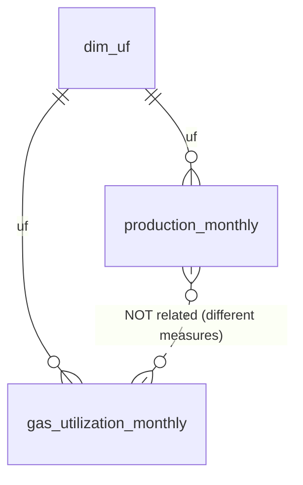

# Tableau Data Model — Oil & Gas

All extracts are in `tableau/data/` (9 CSVs, about 8.7 MB, rebuilt by `python -m oilgas.pipeline`). Columns are described in
[DATA_DICTIONARY.md](DATA_DICTIONARY.md).

Standalone tables: `annual_summary`, `regional_hhi`, `structural_breaks`, `anomalies`, `seasonality`, `metadata`.

## The `level` column: the one rule that matters

`production_monthly` and `gas_utilization_monthly` stack **four aggregation levels** in one file (national, location, uf,
uf_location). This keeps the dashboard to two sources. The cost is that **every sheet must filter to exactly one `level`**.
Summing across levels would count each volume up to four times.

| Sheet type | `level` filter | Other filters |
|---|---|---|
| National KPIs and trend | `national` | `product` |
| Onshore vs offshore | `location` | `product` |
| State map, ranking, share | `uf` | `product`, year |
| State × location detail | `uf_location` | `product`, `uf` |

Apply `level` and `product` as **context filters** on every sheet (or as a single-value data-source filter on duplicated
sources). The Phase 9 build guide lists them per sheet.

## Relationships

| Left | Right | Fields | Note |
|---|---|---|---|
| `dim_uf` | `production_monthly` | `uf = uf` | Rows with `uf = All` have no match. That is expected |
| `dim_uf` | `gas_utilization_monthly` | `uf = uf` | Same |

## Grain and safe aggregation

| Table | Grain | Additive | Non-additive |
|---|---|---|---|
| `production_monthly` | level × UF × location × product × month | `volume` (one level, one product), `days_in_month` (for weighted averages) | every ratio, rolling value, peak, z-score; `daily_avg` (recompute) |
| `gas_utilization_monthly` | level × UF × location × month | all `_1000m3` flows | all rates (recompute as SUM/SUM) |
| `annual_summary` | year × product | — | all |
| others | one row per item | — | all |

Daily averages over any period must be recomputed as `SUM([volume]) / SUM([days_in_month])`. Never average `daily_avg`.

## Field settings

| Field | Setting |
|---|---|
| `uf` | Geographic role State/Province (Country = Brazil); `All` will not geocode, filter it out |
| `period_date` | Date (month) |
| `year`, `month` | Discrete |
| `product` | Dimension; never aggregate across products |
| `is_*`, `allocation_sensitive` | Boolean |

## Size
About 41 k rows in total; the largest is `production_monthly.csv` (29,631 rows, 6.8 MB). Well inside Tableau Public limits.
